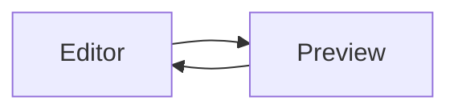

# Getting started

This guide takes you from an installed Clanky binary to a first task.

## Requirements

- Git
- An installed harness runtime with its required authentication: native Copilot,
  Codex, OpenCode 2, or an ACP-capable integration
- Bun when running Clanky from source

ACP presets can use their provider package through `npx` or `bunx` when supported.
Native adapters require the installed CLI on the selected execution host.
See [harness adapters](harnesses.md) for versions, host support and authentication.

## Start Clanky

Use the installed binary:

```bash
clanky serve
```

Or run the combined server and web application from a source checkout:

```bash
bun install
bun dev
```

Open <http://localhost:3000>. The default bind address is `127.0.0.1` and the
default port is `3000`. Set `CLANKY_HOST` or `CLANKY_PORT` when the server
needs a different interface or port.

For a detached local server, use:

```bash
clanky serve up
clanky serve status
clanky serve down
```

## Authenticate the CLI

The browser uses passkey-backed authentication. The CLI can use the device
authorization flow:

```bash
clanky auth --base-url http://localhost:3000
clanky status
```

After authentication, discover and call endpoints with:

```bash
clanky api
clanky schema tasks
clanky api tasks --method GET
clanky ws
```

For unattended scripts, set `CLANKY_BASE_URL` and `CLANKY_API_KEY` instead of
storing credentials in a CLI profile. Keep the key out of shell history and
logs.

## Create a workspace

1. Open **Servers** and select an execution host. A local host is the simplest
   option; SSH and Mesh hosts run repository operations on another machine.
2. Create a workspace and select its repository, host and harness adapter.
   ACP additionally selects a known harness preset.
3. Wait for the workspace to become ready.
4. Open a chat for interactive work, or create a task for an autonomous run.

Automatic Devbox workspaces use a dedicated Mesh worker by default. If you
need a remote host, a worker, or a relay, start with the
[Mesh worker guide](mesh-worker.md).

## Run and review a task

Write the task prompt and choose the model and variant. Plan mode lets you
review a generated plan before code changes begin. During and after execution
you can inspect logs, the diff, and the task state.

Active thinking and tool-activity labels in chat and task transcripts use a
dot and a gentle breathing effect across the whole label. Active text uses
contrasting colors and stays at or above 50% opacity throughout the pulse.
Completed activity keeps its static, muted styling. The effect is disabled
when your system requests reduced motion.

When the browser tab is hidden, chat, task, and agent transcripts defer grouping
and rendering new content, pause the activity animation, and stop automatic
scrolling. Event reception and data updates continue. Returning to the tab
reopens realtime subscriptions and recovers the current state without a page
reload; drafts, expanded entries, and the scroll position remain preserved.

Unchanged message rows are reused during streaming and transcript refreshes,
and unchanged Markdown is not reparsed for playback or local UI updates.
Content changes, display preferences, and message actions still update normally.

Realtime subscriptions filter events before updating React state. Callback-only
streams and resource refresh subscriptions do not retain an unused last-event
state; matching events, authoritative data refreshes, and connection recovery
continue normally.

Streaming chat activity timestamps in the sidebar are grouped into one update
per minute while activity is pending. Status changes and user actions remain
immediate, including blocking questions in chats that are not selected.
Chat state is ordered by a persisted server revision, not activity timestamps,
so provider clock skew cannot hide a transition and a delayed response cannot
overwrite newer state. Connecting or reconnecting realtime refreshes the
authoritative state to recover changes made before the subscription was ready.
Recovery runs on every physical connection opening, independently of React
connection-status renders. Unresponsive connections reconnect automatically;
chat-list and transcript snapshot reads have a 10-second deadline so a stalled
request cannot indefinitely block queued recovery. Timeouts surface through
the normal load-error state rather than triggering periodic HTTP polling.
The header, sidebar, and open chat share that revisioned operational state:
an accepted action response or a detailed snapshot updates all three, without
depending on a second realtime notification reaching the sidebar.
Detail views release their write access on close, and removing a chat revokes
existing detail writers, so delayed action responses cannot restore removed
metadata. New views and explicit chat creation can still load initial state.
Open chats keep their transcript live without republishing operational state
solely because an activity timestamp or revision advanced.

Chat, task, and agent transcripts publish streamed text, reasoning, and tool
extras to React as their events arrive, without an app-owned batching timer.
Complete messages, interactions, status changes, and explicit transcript loads
also publish immediately. Snapshot refresh coalescing and gap recovery remain
independent of streamed delta delivery.

New assistant prose in chats, including embedded task chats, uses a brief
opacity and light-blur reveal as streamed fragments arrive. It does not queue
or delay text delivery, animate user messages, or replay loaded history.
Code blocks, tables, diagrams, and explicit links keep their normal rendering.
The reveal also works with Markdown rendering disabled and is skipped when
the system requests reduced motion.
Each arriving fragment finishes its 400 ms reveal while subsequent fragments
arrive; new text does not cancel or restart the preceding fragment's fade.

Agent, chat, and task status text and transcript activity summaries use a brief
fade, light blur, and small vertical movement when their actual state changes.
The latest status is shown immediately, without queuing previous labels or
simulating progress. Initial rendering, hidden-tab updates, and reduced-motion
preferences do not trigger the transition.

When the result is ready:

- accept it locally when you want to keep the worktree without pushing;
- push it when the branch is ready for review;
- discard it when the changes should not be kept.

Completed or accepted work can receive follow-up prompts and review comments.
The dashboard exposes these actions from the task view.

Dashboard **History** uses the same detailed rows as **Active Work**: workspace
identity or server name, status, time since the last interaction, and item type.
Workspace chats also show their harness provider icon. Private entries remain
obscured when private items are hidden.

## Manage files in Code Explorer

Right-click a file or folder in the tree to open its context menu. The menu is
also available from the keyboard with **Shift+F10** on the focused entry.

Files offer **Download**, **Rename**, and **Delete**. Folders offer **Rename**
and **Delete**; deleting a folder also deletes its contents and requires
confirmation. Actions target that entry without opening it or expanding it first,
in both workspace and server explorers.

Save or discard unsaved edits before renaming or deleting the open file or a
folder containing it. Renaming a folder keeps a clean open file available at its
new path. A pending rename or deletion keeps its dialog open until the operation
finishes. Files still awaiting large-file confirmation keep that warning at the
renamed path rather than loading automatically.

## Preview Markdown files and diagrams

In **Code Explorer**, open a `.md` or `.markdown` file and select **Preview**.
Extensions are case-insensitive. You can also select **Markdown** in the
language selector for other text files. Select **Code** to return to the editor.

Code Explorer automatically applies C# syntax highlighting to `.cs` files and
Rust syntax highlighting to `.rs` files; extensions are case-insensitive. You
can also select **C#** or **Rust** in the language selector for other text files.

Preview uses the current editor text, including unsaved edits. Switching views
does not save or reload the file and keeps the editor's undo history. **Save**
and **Refresh file** retain their usual behavior, including unsaved-change
conflict prompts.

Regular fenced code blocks in Markdown previews, chat messages, and agent logs
include a copy button that copies the code without its Markdown fences.

Mermaid diagrams render in file previews and in agent messages and logs when
Markdown rendering is enabled. Use a fenced block with the `mermaid` language:

````markdown

````

Diagrams follow the light/dark theme and render locally in the browser.
Invalid or incomplete diagrams show their source and an inline error without
interrupting the surrounding Markdown; correcting the source updates the
diagram. Diagram source is limited to 50,000 characters. Raw-text mode keeps
the original Mermaid code. Raw HTML and diagram click callbacks are not enabled.

## Common next steps

- [Deploy Clanky with Docker or a reverse proxy](deployment.md)
- [Configure a Mesh worker or relay](mesh-worker.md)
- [Automate tasks and workspaces](API.md)
- [Run and test Clanky from source](development.md)
