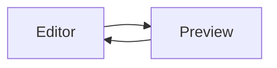

# Getting started

This guide takes you from an installed Clanky binary to a first conversation.
For an end-to-end Mac or manual-controller setup, Tailscale browser/iPhone
access, Quick Chat and optional Voice, use the
[everyday-use guide](everyday-use.md).

## Requirements

- Git
- An installed harness runtime with its required authentication: native Copilot,
  Codex, OpenCode 2 or Claude Code
- Bun when running Clanky from source

Native adapters require the installed CLI on the selected execution host.
See [harness adapters](harnesses.md) for versions, host support and authentication.

## Start Clanky

Use the installed binary:

```bash
clanky serve
```

Or run the combined server and web application from a source checkout:

```bash
bun install
bun dev
```

Open <http://localhost:3000>. The default bind address is `127.0.0.1` and the
default port is `3000`. Set `CLANKY_HOST` or `CLANKY_PORT` when the server
needs a different interface or port.

For a detached local server, use:

```bash
clanky serve up
clanky serve status
clanky serve down
```

## Authenticate the CLI

On a fresh controller, open its localhost URL and create the owner with a
passkey, or initialize the owner with a password through the
[local setup flow](deployment.md#optional-controller-managed-https).
For remote access under a different hostname, add a password before switching:
a localhost passkey cannot authenticate at the Tailscale hostname.

The browser supports passkey, password or API-key authentication with equivalent
account capabilities. The CLI can use the device authorization flow:

```bash
clanky auth --base-url http://localhost:3000
clanky status
```

Device sessions default to `clanky-cli-<hostname>`, so computers with different
hostnames can stay signed in independently. After upgrading from a version
that used the shared `clanky-cli` ID, run `clanky auth` again on each computer;
existing credentials retain their saved client ID until reauthentication.
Computers sharing a hostname or independent profiles on one computer need
distinct `--client-id` values. Authenticating again with the same client ID
replaces its previous session.

After authentication, discover and call endpoints with:

```bash
clanky api
clanky schema chats
clanky api chats --method GET
clanky ws
```

For unattended scripts, set `CLANKY_BASE_URL` and `CLANKY_API_KEY` instead of
storing credentials in a CLI profile. Keep the key out of shell history and
logs.

## Create a workspace

1. Open **Servers** and select an execution host. A local host is the simplest
   option; Mesh hosts run repository operations on another machine.
2. Create a workspace and select its repository, host and harness adapter.
3. Wait for the workspace to become ready.
4. Open a chat for interactive work, optionally selecting **Start with a plan**.

Automatic Devbox workspaces use a dedicated Mesh worker by default. If you
need a remote host, a worker, or a relay, start with the
[Mesh worker guide](mesh-worker.md).

## Plan and implement in one chat

Manage your personal prompt templates in **Settings → Content → Templates**.
Selecting a template fills the composer; review or edit the message before
sending it.

**Prepare a plan** is a built-in template, enabled by default. Its row in
template settings can be enabled, disabled and moved up or down among your
custom templates, but not edited or deleted. The selector follows that saved
order; disabling the built-in does not lose its position.
Selecting it adds visible planning instructions before your existing draft,
without removing text or attachments or sending automatically. It uses the
conversation so far, records completed and remaining work, and waits for your
explicit implementation request. You can use it later in an ordinary chat.

Choose the model and variant, then write your requirements in the normal
composer. **Start with a plan** adds guidance only to that first message:
investigate, ask questions, write `.clanky-planning/plan.md` and `status.md`,
and wait for your instruction before implementation. The complete guidance
appears before your requirements in the first user message in the transcript,
including after reloading; it is sent only once. This is guidance, not a
technical filesystem restriction. Later discussion, plan revisions and the
instruction to implement are ordinary messages, without approval buttons or
an automatic implementation transition.

Open **Plan** in the chat's top-right menu to read the plan followed by
**Status**, the agent's progress, remaining work and blockers. The same composer
stays visible below the documents on desktop and mobile. Switching back to the
conversation preserves your draft and attachments; the files remain accessible
during implementation, even in chats not started with planning.
Use **Back to chat** beside **Created by** above Plan or Diff content to return
to the messages without changing conversations or adding a separate title row.

**Diff**, beside **Activity**, shows committed branch changes and pending
changes, including new files. Individual patches load only when you expand a
file; new-file line counts appear after opening it. Repository details live in
the composer options panel containing **Usage**. A single compact row shows the
actual branch, truncated when needed; select it to copy the complete name.
An existing PR appears as a linked number with a green open, red closed or
purple merged icon. An open PR takes priority; otherwise the most recently
created PR for that branch is shown. These are passive
reads; Git changes, publication and review remain ordinary agent instructions
or your own tools.

Image previews from supported image-reading tools appear directly in chat and automation conversations, with the filename below the image. Select an image to
open the full-size viewer. Images stay visible between independently collapsible
tool or thinking groups, including when reopening or loading older conversation
history. These image entries replace the tool's technical disclosure in the
transcript; calls without a valid preview keep their ordinary tool details.

Conversations update live while connected. Returning to a hidden tab or
reconnecting refreshes the current state without a page reload, preserving
drafts, expanded entries and reading position.

Messages longer than 100,000 characters initially show a preview in chat and automation conversations. Select **Show full message** beside the character count
to display that message in full; opening a very large message may briefly pause
the browser. Shorter messages and attachments are unchanged. This display limit
does not shorten saved messages, API responses, transcript exports, or the text
used by message actions. Expansion is local to the mounted message and is not
saved. A code block cut by the preview can only be copied after expansion;
completed blocks remain copyable. A clipped Mermaid block stays as code until
expanded.

Chat ages and recency ordering use the newer of the last user message and the
last status change, falling back to chat creation. Streaming text and tool
activity do not reset that age.

Dashboard **History** uses the same detailed rows as **Active Work**: workspace
identity or server name, status, time since the last interaction, and item type.
Workspace chats also show their harness provider icon. Private entries remain
blurred when private items are hidden. Hover to reveal them on devices with a
mouse, or use **Show private items** to reveal them immediately.

In Dashboard **Resources**, each workspace's **sessions** count includes its
standalone chats, including history. Automation conversations are not counted
again; terminal sessions remain separate.

## Manage files in Code Explorer

Right-click a file or folder in the tree to open its context menu. The menu is
also available from the keyboard with **Shift+F10** on the focused entry.

Files offer **Download**, **Rename**, and **Delete**. Folders offer **Rename**
and **Delete**; deleting a folder also deletes its contents and requires
confirmation. Actions target that entry without opening it or expanding it first,
in both workspace and server explorers.

Save or discard unsaved edits before renaming or deleting the open file or a
folder containing it. Renaming a folder keeps a clean open file available at its
new path. A pending rename or deletion keeps its dialog open until the operation
finishes. Files still awaiting large-file confirmation keep that warning at the
renamed path rather than loading automatically.

## Preview Markdown files and diagrams

In **Code Explorer**, open a `.md` or `.markdown` file and select **Preview**.
Extensions are case-insensitive. You can also select **Markdown** in the
language selector for other text files. Select **Code** to return to the editor.

Code Explorer automatically applies C# syntax highlighting to `.cs` files and
Rust syntax highlighting to `.rs` files; extensions are case-insensitive. You
can also select **C#** or **Rust** in the language selector for other text files.

Preview uses the current editor text, including unsaved edits. Switching views
does not save or reload the file and keeps the editor's undo history. **Save**
and **Refresh file** retain their usual behavior, including unsaved-change
conflict prompts.

Regular fenced code blocks in Markdown previews, chat messages, and agent logs
include a copy button that copies the code without its Markdown fences.

Mermaid diagrams render in file previews and in agent messages and logs when
Markdown rendering is enabled. Use a fenced block with the `mermaid` language:

````markdown

````

Diagrams follow the light/dark theme and render locally in the browser.
Invalid or incomplete diagrams show their source and an inline error without
interrupting the surrounding Markdown; correcting the source updates the
diagram. Diagram source is limited to 50,000 characters. Raw-text mode keeps
the original Mermaid code. Raw HTML and diagram click callbacks are not enabled.

## Common next steps

- [Set up Quick Chat and use Clanky from Mac to iPhone](everyday-use.md)
- [Deploy Clanky with Docker or a reverse proxy](deployment.md)
- [Configure a Mesh worker or relay](mesh-worker.md)
- [Automate conversations and workspaces](API.md)
- [Run and test Clanky from source](development.md)
